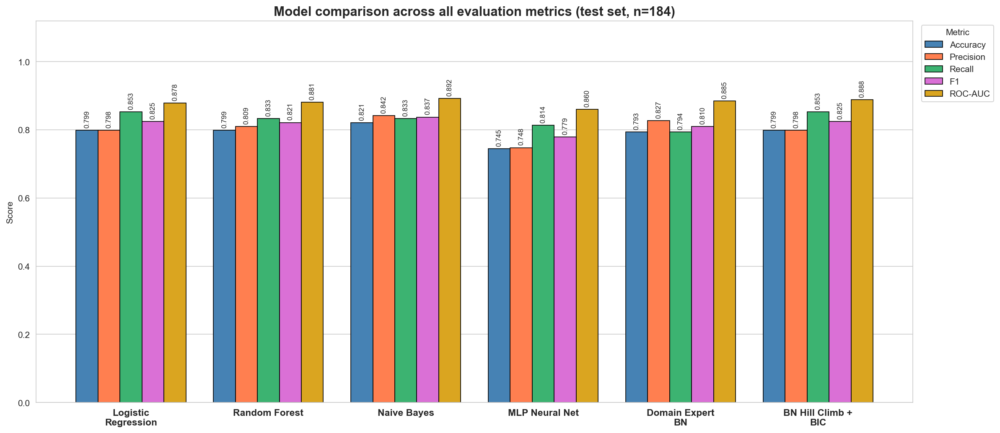
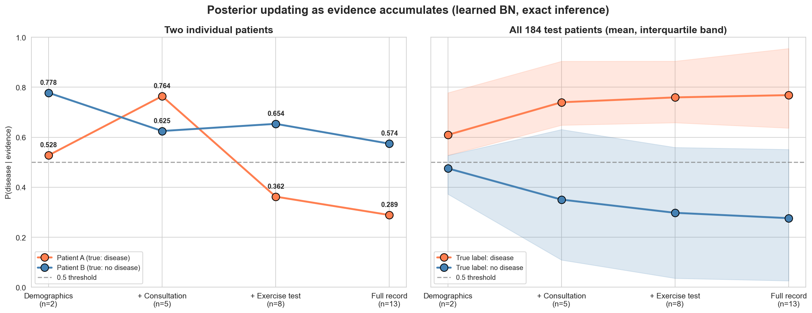
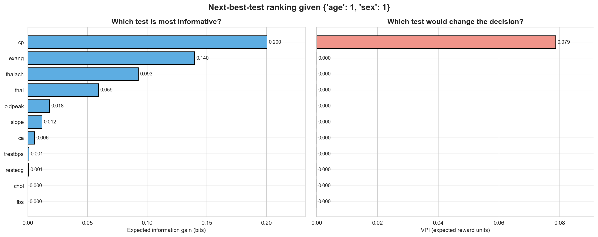
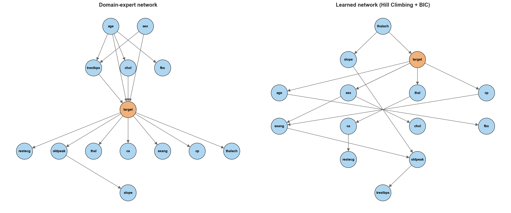
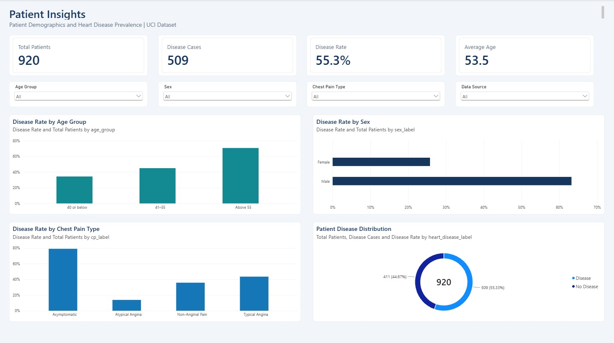
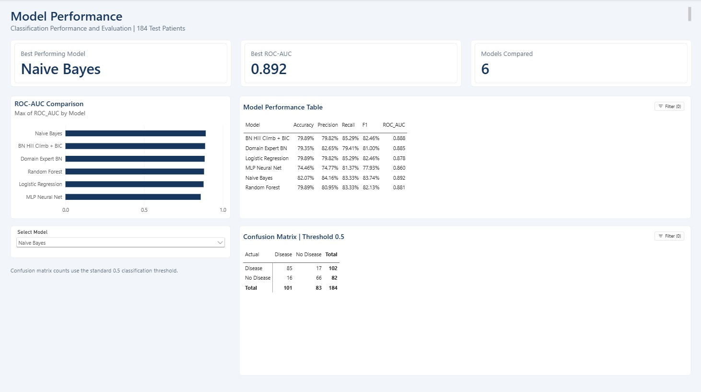
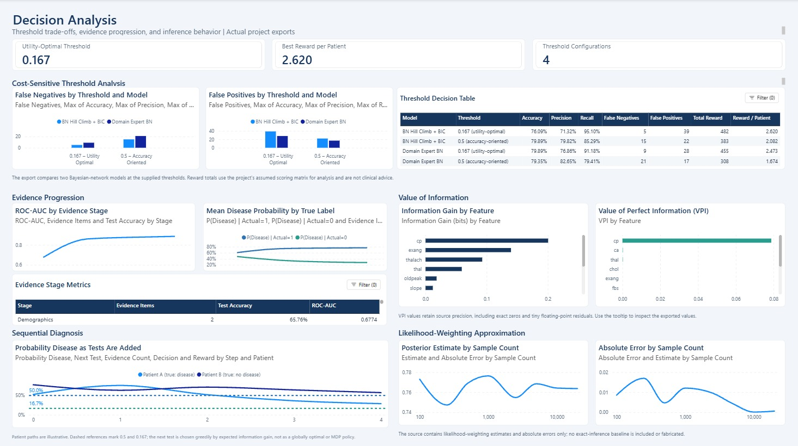

# Heart Disease Prediction using Bayesian Networks

## Overview

This project predicts the presence of heart disease from the four UCI Heart Disease databases
(920 patients in total) and compares four standard classifiers against two Bayesian Networks: one
whose structure is written by hand from clinical reasoning, and one learned from data with Hill
Climbing on the BIC score.

The reason for using Bayesian Networks is that a real patient rarely has every test result
available at once. A trained classifier needs all 13 features to produce an output, whereas a
Bayesian Network can compute `P(disease | evidence)` for any subset of observed features, and can
be asked which test is worth ordering next.

The dataset is small and decades old, with substantial missing data. Nothing here has been
validated on any external population, and none of it is a diagnostic tool.

## Problem Statement

The project compares conventional classifiers and Bayesian Networks for binary heart-disease
prediction, then examines how Bayesian Network probabilities and test-selection decisions behave
when only partial clinical evidence is available. The analysis is educational and is not intended
for clinical use.

## Dataset

Four `processed.*` files from the UCI Machine Learning Repository
([dataset 45, Heart Disease](https://archive.ics.uci.edu/dataset/45/heart+disease)), combined into
one table:

| File | Institution | Records |
|---|---|---|
| `processed.cleveland.data` | Cleveland Clinic Foundation | 303 |
| `processed.hungarian.data` | Hungarian Institute of Cardiology, Budapest | 294 |
| `processed.switzerland.data` | University Hospital, Zurich | 123 |
| `processed.va.data` | V.A. Medical Center, Long Beach | 200 |
| **Total** | | **920** |

13 clinical features: `age`, `sex`, `cp`, `trestbps`, `chol`, `fbs`, `restecg`, `thalach`, `exang`,
`oldpeak`, `slope`, `ca`, `thal`.

The target is the `num` column binarised to 0 (no disease) against 1–4 (disease present), giving a
55.3% disease rate. Split 80/20 with stratification: 736 training and 184 test patients.

Full column codebook, missing-value counts and download instructions are in
[data/README.md](data/README.md). The raw files are not committed; the notebook downloads them on
first run.

## Approach

1. **Preprocessing.** `chol = 0` and `trestbps = 0` are the sites' code for "not measured" and are
   recoded as missing. `oldpeak = 0` is left alone, because it is a real, common reading.
   The train/test split happens before any statistics are computed, imputation uses
   training-set modes only, and the five continuous features are then binned at clinically
   conventional cut-points.
2. **Exploratory analysis** of feature distributions, correlations and class balance, on the
   training split only.
3. **PCA and K-Means** (k = 2) on the standardised continuous features, to check whether the
   classes separate without labels.
4. **Four supervised baselines** trained on the discretised features.
5. **Two Bayesian Networks**, both fitted with a `BayesianEstimator` under a BDeu prior.
6. **Exact and approximate inference**, including queries from partial evidence.
7. **Test selection** by expected information gain and Value of Perfect Information.
8. **Sequential diagnosis** with a cost-sensitive decision threshold derived from a reward matrix.

Exploratory analysis includes feature distributions, correlations and class balance, followed by
PCA and two-cluster K-Means on standardised continuous features. These descriptive and unsupervised
analyses are run on the training split; they do not replace the held-out evaluation.

## Models

- Logistic Regression
- Random Forest
- Naive Bayes (`CategoricalNB`)
- MLP Neural Network
- Domain-expert Bayesian Network (structure written by hand)
- Learned Bayesian Network (Hill Climbing + BIC)

## Probabilistic Inference

- **Variable Elimination** for exact posteriors. Used to classify the test set and to answer
  partial-evidence queries.
- **Likelihood Weighting** for approximate inference. Samples are weighted by the likelihood of
  the evidence and the estimate is the weighted mean. Correctness is checked against the exact
  Variable Elimination answer for the same query: the estimate is within 0.02 at 100 samples and
  within 0.0003 at 20,000.
- **Partial evidence.** The network is queried with progressively more of a patient's record
  (demographics, then consultation, then exercise test, then full record). Averaged over all 184
  test patients, ROC-AUC rises from 0.677 with two features to 0.888 with all thirteen, and the
  mean posterior for the two true classes separates at each stage.
- **Value of information.** For each unobserved feature, expected information gain (mutual
  information with the diagnosis, in bits) and VPI (expected utility gain under the reward matrix).
- **Sequential diagnosis.** The notebook follows two illustrative held-out cases, adding tests
  greedily by expected information gain and recalculating the posterior and reward after each step.
  This is an example of the workflow, not a learned or globally optimal diagnostic policy.

## Evaluation

Accuracy, precision, recall, F1 and ROC-AUC, on the held-out 184-patient test set at a 0.5
threshold. Confusion matrices and false-negative counts are reported per model, and a separate
analysis compares the 0.5 threshold against the utility-optimal one.

## Results

| Model | Accuracy | Precision | Recall | F1 | ROC-AUC |
|---|---|---|---|---|---|
| Naive Bayes | **0.8207** | 0.8416 | 0.8333 | **0.8374** | **0.8918** |
| BN Hill Climb + BIC | 0.7989 | 0.7982 | 0.8529 | 0.8246 | 0.8879 |
| Domain Expert BN | 0.7935 | 0.8265 | 0.7941 | 0.8100 | 0.8850 |
| Random Forest | 0.7989 | 0.8095 | 0.8333 | 0.8213 | 0.8812 |
| Logistic Regression | 0.7989 | 0.7982 | 0.8529 | 0.8246 | 0.8782 |
| MLP Neural Net | 0.7446 | 0.7477 | 0.8137 | 0.7793 | 0.8599 |

Five of the six models sit within 2.7 accuracy points of each other; only the MLP falls away. With
184 test patients, one accuracy point is fewer than two patients, so the ordering among those five
is not something a single train/test split can establish. Naive Bayes leads on accuracy and
ROC-AUC, but not by a margin this evaluation supports.



**Partial-evidence inference.** The property none of the baselines have. Averaged across the test
set, the posteriors for the two true classes separate steadily as evidence arrives.



**Informative is not the same as decision-relevant.** Given only age and sex, several tests reduce
uncertainty about the diagnosis, but only `cp` has non-zero VPI, because only its result could
change which decision gets taken.



**Network structures.** The domain network places `target` between the risk factors and the
observations. Hill Climbing with BIC returns a much sparser graph: the Markov blanket of `target`
is just `age, cp, exang, sex, thal, thalach`, so no other feature changes `P(target)` once those
are observed.



**Threshold and cost.** With rewards of +5 / +2 / −1 / −10 for TP / TN / FP / FN, the
utility-maximising threshold is 3/18 = 0.167, not 0.5. Moving to it roughly halves false negatives
on both networks (21 → 9 and 15 → 5) and raises total test-set reward, at a cost in precision.

Other figures in [results/](results/): `eda_distributions.png`, `correlation_and_balance.png`,
`pca_kmeans.png`, `approx_vs_exact.png`, `sequential_diagnosis.png`, `confusion_matrices.png`,
`accuracy_vs_interpretability.png`.

## Power BI Dashboard

The PBIP report contains three pages:

- **Patient Insights** — aggregate patient counts, disease prevalence, age and sex comparisons,
  chest-pain categories, and patient-disease distribution.
- **Model Performance** — held-out metrics for all six models, ROC-AUC comparison, and a
  model-selectable confusion matrix at the 0.5 threshold.
- **Decision Analysis** — threshold trade-offs, evidence-stage metrics, information gain and VPI,
  sequential-diagnosis examples, and likelihood-weighting estimates.

The six aggregate Power BI CSV exports and their data dictionary are in
[`results/powerbi/`](results/powerbi/README.md). The patient-level and sequential-example exports
are generated locally by the notebook but excluded from Git. Run the notebook through its final
**Power BI Data Export** cell before refreshing the report.

### Dashboard Screenshots

These are existing dashboard captures; they are not generated by the notebook.







To open the report, open [`powerbi/Heart_Disease_Analytics.pbip`](powerbi/Heart_Disease_Analytics.pbip)
in Power BI Desktop. The semantic model uses the `AnalysisDataFolder` Power Query parameter. It is
configured for this workspace's local `results/powerbi/` directory; on another machine, update it
to that clone's local path ending in `results/powerbi` before refreshing.

## Technologies

Python, JupyterLab, pandas, NumPy, scikit-learn, pgmpy, Matplotlib, Seaborn, NetworkX, Power BI
Desktop, PBIR, and TMDL.

## Repository Structure

```
heart-disease-prediction/
├── README.md
├── requirements.txt
├── .gitignore
├── data/
│   └── README.md
├── notebooks/
│   └── heart_disease_prediction.ipynb
├── powerbi/
│   ├── Heart_Disease_Analytics.pbip
│   ├── Heart_Disease_Analytics.Report/
│   └── Heart_Disease_Analytics.SemanticModel/
├── results/
│   ├── powerbi/
│   │   ├── powerbi_model_metrics.csv
│   │   ├── powerbi_confusion_matrix.csv
│   │   ├── powerbi_threshold_comparison.csv
│   │   ├── powerbi_evidence_stages.csv
│   │   ├── powerbi_voi_ranking.csv
│   │   ├── powerbi_likelihood_weighting.csv
│   │   └── README.md
│   └── *.png
└── screenshots/
    ├── patient-insights.png
    ├── model-performance.png
    └── decision-analysis.png
```

The four UCI `.data` files and two local Power BI exports are downloaded or generated locally and
ignored by Git. The Power BI report definitions and aggregate result CSVs are not ignored.

## Setup

### 1. Clone the repository

```bash
git clone https://github.com/VishalVaibhav22/heart-disease-prediction.git
cd heart-disease-prediction
```

### 2. Install the dependencies

```bash
python -m venv .venv
# Windows:
.venv\Scripts\activate
# macOS / Linux:
source .venv/bin/activate

pip install -r requirements.txt
```

`pgmpy` 1.0 or newer is required. Earlier versions name the classes differently, so the imports
will fail.

### 3. Get the data

Nothing to do if you have an internet connection: the notebook downloads the four `processed.*`
files into `data/` on its first run. To place them manually instead, follow
[data/README.md](data/README.md).

### 4. Run the notebook

From the repository root:

```bash
jupyter lab
```

Then open `notebooks/heart_disease_prediction.ipynb` and run all cells from the top.

The notebook does not depend on the working directory it is launched from. Its configuration cell
locates the repository root by walking up from the current directory until it finds
`notebooks/heart_disease_prediction.ipynb`, and builds every data and output path from there. That
means it behaves the same whether the kernel starts in `notebooks/` (Jupyter's default) or at the
repository root (which some editors, including VS Code with `jupyter.notebookFileRoot` set to the
workspace folder, do instead). Data is always read from `data/` and figures are always written to
`results/` inside the repository, never beside it.

A full run takes a few minutes; the slowest parts are the per-patient Variable Elimination queries
and the Likelihood Weighting sweep.

Verified end to end on Python 3.13.3 with pgmpy 1.0.0, scikit-learn 1.7.0, pandas 2.3.0 and
numpy 2.3.1.

### Refresh the Power BI report

After running the notebook through the final export cell, open
`powerbi/Heart_Disease_Analytics.pbip` in Power BI Desktop and refresh the semantic model. The
`AnalysisDataFolder` parameter must point to the local `results/powerbi/` directory. Its value in
this workspace is machine-specific; set it to the equivalent directory on any other machine before
refreshing. The two ignored local exports (`powerbi_patients.csv` and
`powerbi_sequential_diagnosis.csv`) are required by the full report and are regenerated by that
notebook cell.

## Limitations

- **Heavy missingness in three columns.** `ca` is missing for 66% of patients, `thal` for 53% and
  `slope` for 34%, almost entirely because the non-Cleveland sites did not record them. Filling two
  thirds of a column with the training mode makes it close to a constant, so any result involving
  `ca` or `thal` should be read with that in mind.
- **Single train/test split.** No cross-validation and no repeated seeds, so the differences
  between the top five models are within noise. Confidence intervals would need repeated
  resampling.
- **Nominal codes treated as numeric.** Logistic Regression, Random Forest and the MLP receive
  `cp`, `restecg`, `slope` and `thal` as integers, which imposes an ordering that does not exist
  for the nominal ones. One-hot encoding would be the correct treatment. The Bayesian Networks and
  `CategoricalNB` are unaffected.
- **Discretisation loses information.** Binning the five continuous features into three levels each
  is needed for the discrete Bayesian Networks but discards resolution the continuous models could
  have used.
- **No hyperparameter tuning.** Every model runs at close to library defaults, so this compares
  untuned baselines rather than best-achievable versions of each method.
- **The reward values are our own.** The +5 / +2 / −1 / −10 matrix is a plausible ordering of
  clinical error costs that we chose ourselves, not values taken from any clinical source. The
  0.167 threshold is only as defensible as those numbers.
- **Structure learning is not fully deterministic.** Hill Climbing can settle on different
  BIC-equivalent edge orientations between runs. The Markov blanket of `target` has been stable
  across our runs, but individual edge directions may differ from those shown above.

## Future Improvements

Evaluate the models with repeated stratified cross-validation and uncertainty intervals; use
one-hot encoding for nominal predictors in models that treat integer codes as ordered; tune
hyperparameters; assess calibration and decision thresholds on additional data; and validate on a
more recent, external population before considering any real-world application.
